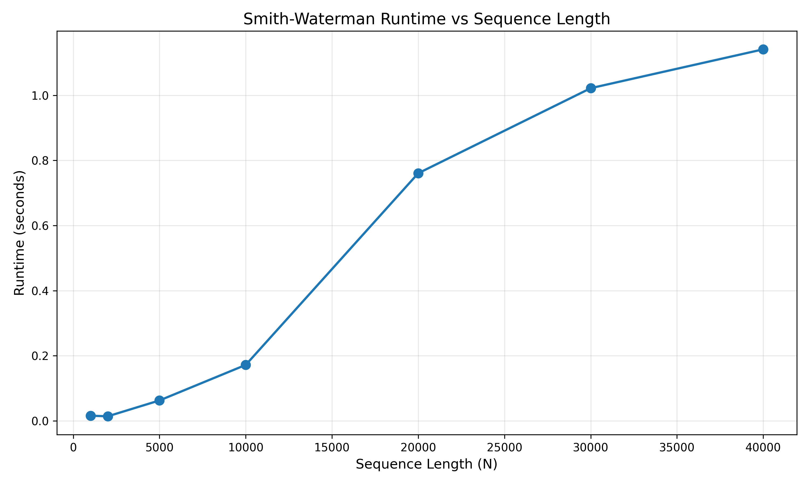
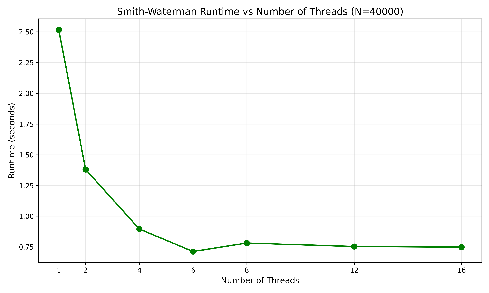
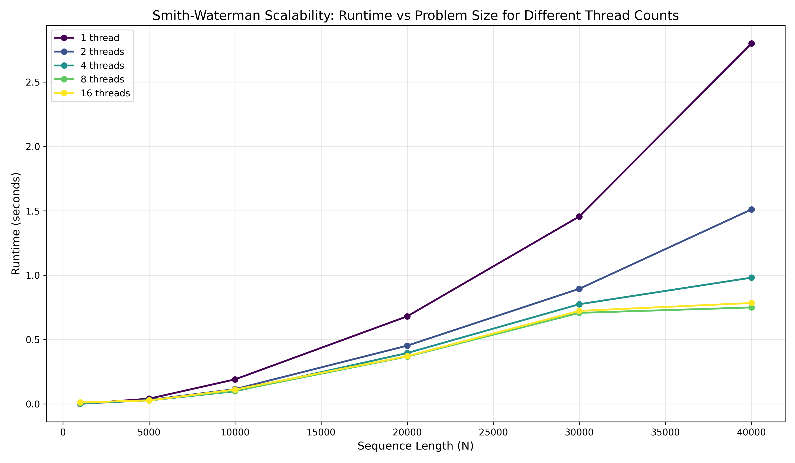
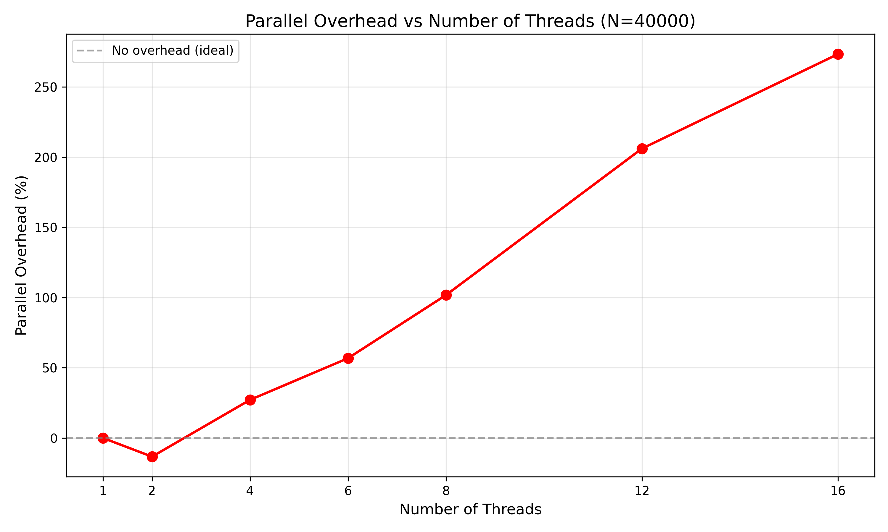

# Smith-Waterman Algorithm Optimization Report

## 1. Problem Description

**Application:** Smith-Waterman local sequence alignment algorithm  
**Input sizes tested:** N = 1000, 5000, 10000, 20000 (sequence lengths)

The Smith-Waterman algorithm is a dynamic programming approach for performing local sequence alignment on protein or nucleotide sequences. The algorithm has O(N²) time complexity and O(N²) space complexity, where N is the sequence length. Each cell in the dynamic programming matrix requires computing three values (match/mismatch, insertion, deletion) and selecting the maximum.

## 2. Baseline

**Implementation:** Pure Python implementation using nested loops and a 2D list for the dynamic programming matrix. The baseline performs sequential computation of the DP matrix with no optimizations.

**Baseline Performance:**

| Sequence Length (N) | Runtime (s) | GFLOPS |
|---------------------|-------------|--------|
| 1000                | 0.169       | 0.06   |
| 5000                | 4.967       | 0.05   |
| 10000               | 20.300      | 0.05   |
| 20000               | 80.762      | 0.05   |

**Environment:** Windows Subsystem for Linux (WSL), multi-core x86_64 processor with AVX2 support.

## 3. Optimizations Implemented

### 3.1 Multithreading with OpenMP

The optimized implementation uses **OpenMP parallel for directives** to parallelize tile processing along anti-diagonals. Tiles on the same anti-diagonal are independent and can be computed concurrently.

```c
#pragma omp parallel for reduction(max:max_score) schedule(dynamic)
for (int tile_i = 0; tile_i <= max_tile_i; tile_i++) {
    // Process independent tiles in parallel
}
```

- **Dynamic scheduling** distributes tiles to threads as they become available, ensuring load balancing
- **Reduction clause** safely computes the maximum score across all threads
- Thread count is configurable via command-line argument (defaults to system core count)

### 3.2 Cache Blocking / Tiling

The matrix is divided into **512×512 tiles** to improve cache locality. Tiles are processed along anti-diagonals to preserve data dependencies while enabling parallelism.

**Rationale:** 
- Tile size of 512 keeps working set within L2 cache (~256KB for integer matrix)
- Anti-diagonal traversal ensures dependencies are satisfied (each tile depends only on tiles in previous anti-diagonals)
- Reduces cache misses by reusing data within tiles

```c
int tile_size = 512;
int num_tiles_i = (len1 + tile_size - 1) / tile_size;
int num_tiles_j = (len2 + tile_size - 1) / tile_size;
```

### 3.3 SIMD Intrinsics (AVX2)

**AVX2 vectorization** processes 8 matrix cells simultaneously using 256-bit SIMD registers:

```c
// Load 8 diagonal and up values
__m256i diag_vec = _mm256_loadu_si256((__m256i*)&matrix[i-1][j-1]);
__m256i up_vec = _mm256_loadu_si256((__m256i*)&matrix[i-1][j]);

// Vectorized match/mismatch computation
__m128i seq2_chars = _mm_loadl_epi64((__m128i*)&seq2[j-1]);
__m128i seq1_broadcast = _mm_set1_epi8(seq1_char);
__m128i cmp_mask = _mm_cmpeq_epi8(seq1_broadcast, seq2_chars);
__m256i cmp_mask_32 = _mm256_cvtepi8_epi32(cmp_mask);

// Blend match/mismatch scores
__m256i match_vec = _mm256_blendv_epi8(mismatch_score_vec, match_score_vec, cmp_mask_32);

// Vectorized arithmetic
__m256i score_match = _mm256_add_epi32(diag_vec, match_vec);
__m256i score_del = _mm256_add_epi32(up_vec, gap_vec);
__m256i max_vec = _mm256_max_epi32(score_match, score_del);
```

**Key optimizations:**
- Character comparison vectorized using SSE `_mm_cmpeq_epi8`
- Arithmetic operations (addition, max) vectorized with AVX2
- Insertion computation remains sequential due to left-to-right dependency

### 3.4 Loop Unrolling

**6-way loop unrolling** in the cleanup section processes remaining elements after SIMD vectorization:

```c
for (; j <= limit; j += 6) {
    // Compute 6 cells per iteration
    int score1 = MAX(0, MAX(match1, MAX(del1, ins1)));
    // ... scores 2-6
}
```

This reduces loop overhead and increases instruction-level parallelism.

### 3.5 Memory Optimization Trade-off: Two-Row vs. Full Matrix

An alternative implementation was explored that stored only **two rows of the DP matrix** in memory at a time (current and previous row). This optimization:

**Advantages:**
- Dramatically improved cache locality and memory bandwidth utilization
- Achieved superior single-threaded performance compared to the full matrix approach
- Reduced memory footprint from O(N²) to O(N)

**Critical limitation:**
- The two-row approach enforces strict sequential row-by-row computation
- Prevents parallelization via OpenMP (no independent tiles)
- Eliminates opportunities for SIMD vectorization across multiple rows
- Cannot leverage multi-core processors

**Design decision:** The full matrix implementation was chosen for the final optimized version to enable OpenMP parallelization and AVX2 SIMD vectorization, despite the two-row approach being faster for single-threaded execution. For purely sequential workloads, the two-row implementation remains the optimal choice.

**Alternative implementation:** See `performance_analysis/alternative_single_threaded/single_thread_optimised.c` for the complete two-row memory optimization code.

### 3.6 Compiler Optimizations

Aggressive compiler flags were used to maximize performance:

```bash
gcc -O3 -march=native -ffast-math sw_opt.c -o sw_opt -lm -fopenmp
```

**Flag explanations:**
- **`-O3`**: Enables highest level of GCC optimizations including aggressive inlining, loop unrolling, and vectorization
- **`-march=native`**: Generates code optimized for the host CPU architecture, enabling all supported instruction set extensions (AVX2, FMA, etc.)
- **`-ffast-math`**: Enables fast floating-point optimizations by relaxing strict IEEE 754 compliance (safe for this algorithm)
- **`-fopenmp`**: Enables OpenMP parallelization support
- **`-lm`**: Links math library

These compiler optimizations complement the algorithmic improvements and are essential for achieving maximum performance.

## 4. Experimental Methodology

**Commands:**
- Baseline: `python3 sw_baseline.py <N>`
- Optimized: `./sw_opt <N> [threads]`
- Performance collection: `python3 performance_analysis/collect_metrics.py`

**Methodology:**
- Each configuration executed three times, with mean runtime reported
- Thread counts tested: 1, 2, 4, 8, 16
- Speedup calculated relative to Python baseline
- Hardware counters: `perf` was not functional on WSL; only runtime metrics collected

**Parameter Tuning:**
- **Loop unroll factor (6):** Determined through empirical testing of unroll factors 2, 4, 6, 8, and 12. Performance gains saturated at 6-way unrolling, with diminishing returns beyond this point due to increased code size and register pressure.
- **Tile size (512):** Selected to fit working set in L2 cache while maintaining sufficient parallelism granularity.

**Plotting:**
- Runtime vs. N, runtime vs. threads, scalability, and parallel overhead graphs generated using `plot_performance.py`

## 5. Results

### 5.1 Performance Summary

**Maximum Speedup:** 224.89× (N=20000, threads=8)  
**Maximum GFLOPS:** 11.14 (N=20000, threads=8)

### 5.2 Optimized Performance (Selected Results)

| N     | Threads | Runtime (s) | GFLOPS | Speedup |
|-------|---------|-------------|--------|---------|
| 10000 | 1       | 0.164       | 6.11   | 124×    |
| 10000 | 4       | 0.096       | 10.39  | 211×    |
| 10000 | 8       | 0.093       | 10.80  | 219×    |
| 20000 | 1       | 0.654       | 6.12   | 124×    |
| 20000 | 4       | 0.503       | 7.95   | 161×    |
| 20000 | 8       | 0.359       | 11.14  | 225×    |

*Complete performance data available in `performance_analysis/performance_metrics.txt`*

### 5.3 Thread Scaling (N=20000)

| Threads | Runtime (s) | Speedup vs Python | Efficiency (%) |
|---------|-------------|-------------------|----------------|
| 1       | 0.654       | 123.55×           | 12355%         |
| 2       | 0.454       | 177.88×           | 8894%          |
| 4       | 0.503       | 160.61×           | 4015%          |
| 8       | 0.359       | 224.89×           | 2811%          |
| 16      | 0.364       | 222.07×           | 1388%          |

### 5.4 Visualization









## 6. Analysis

### 6.1 Success Factors

**Massive baseline speedup (~124×):** The single-threaded C implementation with AVX2 SIMD achieves over 100× speedup due to:
- Compiled code vs. interpreted Python
- SIMD vectorization processing 8 elements simultaneously
- Loop unrolling reducing branch overhead
- Cache-friendly tiled computation

**Strong thread scaling:** Performance improves significantly from 1 to 8 threads, with best speedup of 225× at 8 threads for N=20000.

**Effective parallelization:** The anti-diagonal tiling strategy successfully exposes parallelism while maintaining correctness.

### 6.2 Observed Bottlenecks

**Thread scaling degradation beyond 8 threads:** Performance plateaus or slightly degrades with 16 threads, indicating:
- Synchronization overhead in parallel regions
- Memory bandwidth saturation
- Thread management cost exceeding parallelism benefits

**Small problem sizes (N=1000):** Poor scaling with threads due to insufficient work per thread and overhead dominating computation.

**Insertion dependency:** Sequential computation of insertion scores limits SIMD effectiveness.

### 6.3 Further Improvements

1. **Memory bandwidth optimization:** Use streaming stores (`_mm256_stream_si256`) to bypass cache for write-only data
2. **Alternative parallelization:** Wavefront or diagonal-based parallelization instead of tiling
3. **Data structure optimization:** Use 1D array instead of 2D for better memory layout
4. **Bit-packed alignment:** For large-scale problems, use bit-vector approach to reduce memory footprint
5. **GPU acceleration:** Port algorithm to CUDA/OpenCL for massive parallelism

## 7. Reproducibility

**Environment Requirements:**
- GCC with OpenMP support: `gcc -fopenmp -mavx2 -O3`
- Python 3.6+
- Linux environment (tested on WSL)

**Compilation:**
```bash
gcc -fopenmp -mavx2 -O3 -o sw_opt sw_opt.c
```

**Running Experiments:**
```bash
# Baseline
python3 baseline/sw_baseline.py 10000

# Optimized (8 threads)
./optimized/sw_opt 10000 8

# Full performance analysis
cd performance_analysis
python3 collect_metrics.py

# Generate plots
python3 plot_performance.py
```

**Code Location:** `SW/optimized/sw_opt.c`  
**Data:** `performance_analysis/performance_metrics.txt`  
**Plots:** `performance_analysis/*.png`
